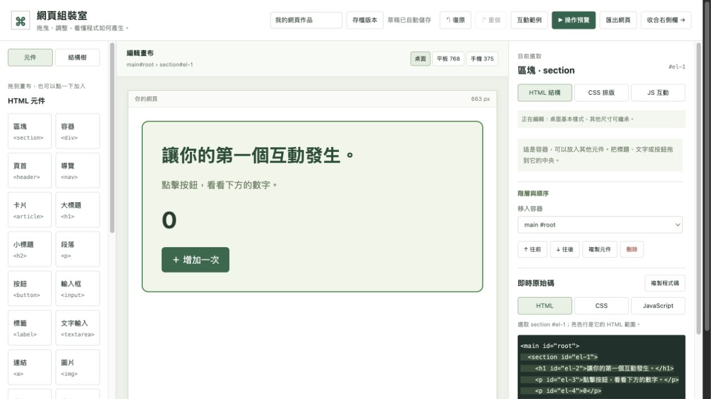

# 網頁組裝室：視覺化前端編輯器

使用原生 HTML、CSS、JavaScript，在瀏覽器中拖放元件、調整排版、組裝互動並匯出獨立網頁。

**[開啟線上版](https://ericcc-zizgf.github.io/visual-page-builder/)** · [GitHub 原始碼](https://github.com/Ericcc-zizgf/visual-page-builder)



## 下載完整程式碼

先確認電腦已安裝 Git。在 Windows 的 PowerShell、macOS 或 Linux 的終端機中，切換到想保存專案的位置，再依序執行：

```sh
git clone https://github.com/Ericcc-zizgf/visual-page-builder.git
cd visual-page-builder
```

第一行會將倉庫中的完整程式碼、說明、測試腳本與圖片下載到新的 `visual-page-builder` 資料夾；第二行會進入該資料夾。不需要登入 GitHub 就能下載此公開倉庫。

如果沒有安裝 Git，也可以到 [GitHub 倉庫](https://github.com/Ericcc-zizgf/visual-page-builder)，點 **Code → Download ZIP**，下載後解壓縮。

## 在自己的電腦啟動

本機啟動需安裝 Python 3。完成下載並進入 `visual-page-builder` 資料夾後，依作業系統執行下列其中一種指令。

### Windows（PowerShell）

```powershell
py -3 -m http.server 5230 --bind 127.0.0.1
```

若系統找不到 `py`，但已安裝 Python 3 並可使用 `python`，可改用：

```powershell
python -m http.server 5230 --bind 127.0.0.1
```

### macOS／Linux（終端機）

```sh
python3 -m http.server 5230 --bind 127.0.0.1
```

啟動後，用瀏覽器開啟 [http://127.0.0.1:5230/](http://127.0.0.1:5230/)。保持終端機執行，結束時按 **Ctrl+C**。macOS 也可在專案資料夾執行 `sh start.command`。

不需要安裝 Python 套件、執行 Node.js 建置或設定 API 金鑰。若只想使用工具，可以直接開啟[線上版](https://ericcc-zizgf.github.io/visual-page-builder/)，不必安裝 Git 或 Python。

## 更新下載的程式碼

如果是使用 `git clone` 下載，在專案資料夾執行：

```sh
git pull --ff-only
```

這會在可以直接更新時取得最新版本；若你修改了本機程式碼而更新發生衝突，請先保留並處理自己的修改，再更新，避免直接覆蓋。

## 專案結構

- `index.html`：編輯器介面。
- `styles.css`：編輯器排版與響應式樣式。
- `app.js`：元件模型、畫布、互動組裝、草稿保存與匯出。
- `tests/`：開發驗證腳本；Playwright 與 Chromium 僅在執行測試時需要。

使用者作品保存在各自瀏覽器的 localStorage，沒有上傳到 GitHub，也不會跨裝置同步。從本機搬到線上後，網址來源不同，舊草稿請先匯出專案 JSON 再匯入。
編輯器本身不需要外部 CDN、字型或 API 服務；外部網站連結僅在使用者主動操作時開啟。
此倉庫未另授予開源授權；公開瀏覽不等同於取得再散布或修改授權。

## 第一次操作

1. 左側拖入「區塊 section」，再將標題、段落、按鈕拖到區塊中央。也可以點擊元件加入目前容器。
2. 點畫布元件，右側 HTML 分頁修改文字、提示、連結、圖片；下方原始碼同步更新並保留縮排。
3. 切換 CSS 排版，設定 Flex／Grid、對齊、間距、寬高、內外距、字體、配色、邊框與定位。可用橫排置中、直向排列、三欄格線快速開始，再調整細項。
4. 切換 JS 互動，選「觸發事件 → 執行動作 → 目標」，按新增互動。下方會產生真正的 addEventListener 程式。
5. 按「操作預覽」實際點按與輸入。編輯畫布的點擊用來選取元件，互動在預覽執行。
6. 按「匯出網頁」下載獨立 HTML，內含 CSS 和 JavaScript，可直接用瀏覽器開啟。

想先看成果，可按「互動範例」，再按「操作預覽」測試計數按鈕。載入範例和清空畫布都能復原。

## HTML 與拖曳

支援 main 畫布，以及 section、div、header、nav、article、h1、h2、p、button、input、label、textarea、a、img、ul、li、form、hr。容器可以嵌套，ul 只放 li，阻止循環巢狀和巢狀表單。清單項目目前是文字元件。

拖到容器中央會放入內部，拖到元件上緣／下緣會插在前後。結構樹也可拖曳。右側可選擇移入哪個容器、往前／往後、複製和刪除。複製容器會為其後代產生新 ID，內部互動的目標也會對應到新 ID。刪除目標時，相關互動會一起移除。

## CSS 與畫布寬度

CSS 控制產生真正的選擇器與屬性，支援一般流、Flex、Grid 和定位。尺寸可輸入 24px、50%、auto；值無效會提示，不會套入。清空欄位可恢復預設。配色可輸入色碼或使用原生選色器。

桌面、平板 768、手機 375 切換編輯目標。桌面設定為基本樣式；平板覆寫會輸出 `@media (max-width: 1024px)`；手機覆寫會輸出 `@media (max-width: 600px)`。未覆寫的屬性繼承較大尺寸。清空欄位會移除該尺寸的覆寫，也可以一次移除本尺寸所有覆寫。

編輯畫布依選擇套用目標樣式；操作預覽與匯出網頁依真正視窗寬度套用媒體查詢。在窄螢幕上，畫布最多顯示可用寬度，頂部會顯示實際像素。

CSS 新增盒模型圖，可分別調整 margin／padding 的上、右、下、左。尺寸欄位可配合數字、加減按鈕與 px／%／rem／em／vw／vh／auto 單位選單；不合法的 CSS 值會提示，不會套用。

## JavaScript 視覺化互動

事件：click、input、change、submit。動作：更新文字、切換 hidden、切換 is-active 樣式、數字加一、把目前輸入值顯示到文字元件。

例如：加入一個 input 和一段 p，選 input → JS 互動 → input 事件 →「將目前輸入顯示成文字」→ 目標選 p。預覽中打字，段落就會同步變化。

可直接編輯既有互動，加入「來源內容是空白／不是空白／等於文字」條件、否則動作及最多 10 個後續動作。輸入框以 value 作為條件來源，其他文字元件以 textContent 為來源。後續動作只在條件成立時依序執行，否則執行另設的動作。

例如：按下按鈕 → 如果輸入框空白 → 段落顯示「請先輸入」→ 接著標題切換醒目樣式；否則段落顯示「輸入有效」。複製容器時，條件來源及各步驟目標都會跟著對應到新元件；刪除被引用的元件，相關互動也會移除，可復原。

目前支援預設條件及事件動作組裝，尚不包含自由輸入的任意程式邏輯、迴圈、遠端 API 或後端。

## 保存與匯出

草稿自動存在目前來源的瀏覽器 localStorage；不會上傳。左上方可設定作品名稱。「存檔版本」可保存帶名稱／備註的設計快照，最多 10 份；還原前會自動備份目前設計。版本與草稿都只存在同一瀏覽器來源，並非雲端同步。圖片較多導致額度不足時會提醒匯出 JSON 或刪除不需要的版本。

復原／重做最多保留 60 步，重新整理後不保留操作歷史；已保存的版本會保留。舊版專案 JSON 和既有草稿仍可載入，會補上名稱及響應式預設。

「儲存專案 JSON」是可重新編輯的設計資料；「載入專案 JSON」可還原設計，包含圖片及互動。圖片接受 2 MB 內 PNG／JPEG／WebP。圖片較多可能超出瀏覽器儲存額度，會提醒下載 JSON。專案載入最多 5 MB、300 元件、15 層巢狀。

「匯出網頁」是可獨立執行的單一 HTML，包含格式化 HTML、CSS、JavaScript 和內嵌圖片，不含編輯標記。匯出的 HTML 不是設計專案檔，重新編輯請保存 JSON。

預覽使用獨立沙箱，不可讀取編輯器儲存；預覽和匯出預設禁止外部資源與原生表單提交。表單互動使用 JavaScript 的 preventDefault()；這個工具本身不提供資料傳送或 API 功能。

## 原始碼對照與拖曳提示

選取元件會標出對應 HTML 範圍並捲到該行，點 HTML 原始碼的元件開頭也能反向選取。CSS 修改會標示剛調整的屬性；新增／變動行會短暫亮起。選到有互動的元件時，畫布用藍框標出相關來源及目標，互動摘要會顯示元件名稱與文字。

拖曳到元件上下緣時會顯示插入線，進入容器中央時顯示容器框；不合法位置會顯示紅框與原因。這些編輯提示不會出現在匯出的網頁中。
